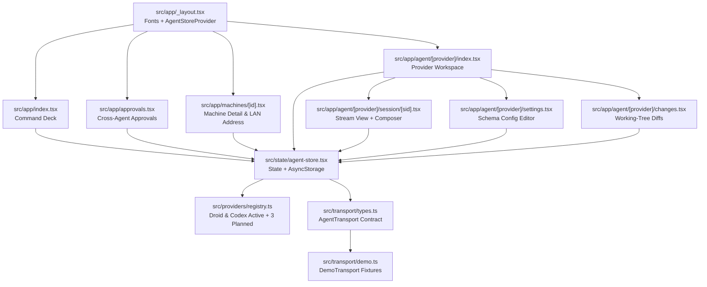

> **Superseded implementation record.** The demo-only specification below describes the earlier UI scaffold. The current native APK, authenticated PTY bridge, provider discovery, settings and run instructions are documented in the root README. Do not use the historical demo boundaries below as a description of current behavior.

# Factory Handoff & Architecture Specification — Astra UI

```
DOCUMENT TITLE: Astra UI — Somnus Command Surface & Architecture Contract
Classification: INTERNAL
Version: 2.0
Date: 2026-10-23
Author/Origin: Colony / Defense-Grade-Doc-Engine (chronicler-1)
Status: OPERATIONAL
```

## 1. Mission & Operational Posture

Astra UI is Daeron's private Android command center for local coding agents, targeting standalone `.apk` deployment on a primary operator handset (Galaxy S24 Ultra) paired over a local network with host rigs running agent backends. The application streams session output, dispatches operator prompts and slash commands, adjudicates tool approvals, inspects working-tree diffs, and edits per-agent configuration schemas.

- **First-class active providers:** Factory Droid (`droid`), OpenAI Codex (`codex`).
- **Registered planned providers:** OpenCode (`opencode`), Google AntiGravity (`antigravity`), DeepSeek Harness (`deepseek`).
- **Sovereign boundary:** Every rig runs its own local backend; the handset acts strictly as an authenticated control and streaming client. Nothing is published to public app stores, and no cloud intermediary, discovery service, or external database is used.

---

## 2. Frozen Visual Contract (Somnus Modernized)

`src/theme/tokens.ts` is the single source of visual truth (owned by Parent). All screens and components must consume these tokens via React Native `StyleSheet` without introducing ad-hoc hex literals or Tailwind/NativeWind compilers.

### 2.1 Surface & Obsidian Stack

| Token Role | Value | Operational Rule |
| --- | --- | --- |
| Canvas | `#05070B` | True obsidian background everywhere, including root container and safe areas |
| Surface L1 | `#0A0E15` | Primary recessed/card container surface |
| Surface L2 | `#0F141D` | Elevated card, row, and control surface |
| Surface L3 | `#151B26` | Interactive/pressed surface and inset code/diff well |
| Hairline Subtle | `rgba(148,163,184,0.10)` | Standard 1px structural borders and dividers |
| Hairline Strong | `rgba(148,163,184,0.18)` | Emphasized boundaries, active input frames, focused cards |

### 2.2 Typography Hierarchy & Scale

| Token Role | Value | Operational Rule |
| --- | --- | --- |
| Text Primary | `#F8FAFC` | Primary headings, active values, command input, primary body copy |
| Text Secondary | `#E2E8F0` | Subtitles, secondary descriptions, active metadata |
| Text Muted | `#94A3B8` | Micro-labels, timestamps, secondary telemetry, inactive tabs |
| Text Faint | `#64748B` | Disabled controls, placeholder hints, low-priority chrome |

- **Font families:**
  - `Inter`: All UI chrome, body copy, labels, and navigation controls.
  - `JetBrains Mono`: Telemetry readouts, diffs, terminal streams, paths, and numeric counters with `tabular-nums`.
  - `Space Grotesk` (`500` weight): Display numerals only.
- **Type scale (px):** `11` / `13` / `15` / `17` / `22` / `28` / `34`.
- **Copy posture:** Operator-grade, terse, uppercase micro-labels with tracked spacing, zero marketing warmth or conversational filler.

### 2.3 Accent, Live Telemetry & Semantic Status

| Role | Value | Usage Constraint |
| --- | --- | --- |
| Primary Accent Gradient | `#3B82F6` → `#8B5CF6` | Restrained blue-violet gradient; permitted **only** on the primary action button, active/selected control state, and focused session indicator |
| Live / Streaming Marker | `#06B6D4` | Active token stream indicator and live rig heartbeat |
| Semantic Nominal / Success | `#10B981` | Always paired with explicit text label (e.g., `NOMINAL`, `APPROVED`, `ONLINE`) |
| Semantic Warning / Pending | `#F59E0B` | Always paired with explicit text label (e.g., `APPROVAL`, `DEGRADED`, `PENDING`) |
| Semantic Critical / Error | `#EF4444` | Always paired with explicit text label (e.g., `ERROR`, `REJECTED`, `OFFLINE`) |

> **Accessibility & Status Invariant:** Never rely on hue alone to communicate operational state. Every semantic color indicator must be paired with an explicit uppercase text label or structural badge.

### 2.4 Glass Hierarchy, Geometry & Motion

- **Glass fills:**
  - Tier 1 (Deep Sheet / Modal): `rgba(8,12,18,0.96)`
  - Tier 2 (Top Bar / Composer Bar): `rgba(15,20,28,0.92)`
  - Tier 3 (Floating Overlay): `rgba(22,29,39,0.85)`
- **Blur budget:** `expo-blur` is restricted strictly to the **top bar**, **composer**, and **modal sheets**. Never stack blur views inside scrollable card lists.
- **Glow budget:** At most **one** restrained violet glow is permitted on active/running states. Inactive elements must remain flat against the obsidian stack.
- **Corner radii (px):** `8` / `12` / `16` / `20` / `24`.
- **Touch targets:** Minimum `48px` hit target on all interactive controls (`hitSlop` where visual geometry is smaller).
- **Motion:** `150ms` micro-interactions, `300ms` sheet/layout transitions, `0.97` press scale feedback, with full respect for system `reduce-motion` preferences.

### 2.5 Visual Avoid List (Prohibited Patterns)

- No legacy lime (`#D7FF62`) or warm gray (`#A0A09A`, `#121212`) palette remnants.
- No default browser/OS blue links.
- No decorative gradients on standard cards.
- No nested glass stacks inside cards.
- No neon glows on inactive elements.
- No hue-only status dots without accompanying text labels.

---

## 3. System Architecture & Routing Topology



### 3.1 Expo Router Screen Map (`src/app/`)

| Route File | Screen Role |
| --- | --- |
| `src/app/_layout.tsx` | Loads `Inter`, `JetBrains Mono`, and `Space Grotesk` fonts; configures obsidian status bar and mounts `AgentStoreProvider` |
| `src/app/index.tsx` | Command deck: rig switcher strip, aggregate pending approvals banner, active provider cards (Droid, Codex), and planned provider roster (OpenCode, AntiGravity, DeepSeek Harness) |
| `src/app/agent/[provider]/index.tsx` | Provider workspace: active rig binding, model/mode readout, session list, quick links to diffs, approvals, and provider settings |
| `src/app/agent/[provider]/session/[sid].tsx` | Session stream view (`StreamView`) with structured tool/diff/reasoning blocks and bottom `Composer` with slash-command completion |
| `src/app/agent/[provider]/settings.tsx` | Schema-driven per-agent configuration screen generated from `src/providers/registry.ts` |
| `src/app/agent/[provider]/changes.tsx` | File-by-file working-tree diff inspector (`DiffCard`) for the selected provider and rig |
| `src/app/approvals.tsx` | Cross-agent execution approval queue (`ApprovalCard`) allowing approve/deny decisions with audit metadata |
| `src/app/machines/[id].tsx` | Rig hardware telemetry, provider availability matrix, and persistent LAN base URL editor |

### 3.2 Non-Route Module Responsibilities

- **`src/theme/tokens.ts`**: Parent-owned frozen Somnus design contract.
- **`src/components/ui/`**: `Shell`, `GlassPanel`, `Button`, `Chip`, `StatusDot`, `SectionHeader`, `Sheet`, `ListRow`, `Metric`, `CodeBlock`, `Icon`.
- **`src/components/agent/`**: `ProviderCard`, `StreamView`, `Composer`, `ApprovalCard`, `DiffCard`.
- **`src/providers/registry.ts`**: Canonical metadata, capabilities, slash commands, and typed setting schemas for all five providers (`droid` and `codex` active; `opencode`, `antigravity`, and `deepseek` planned).
- **`src/transport/types.ts`**: Pure TypeScript contract (`AgentTransport`) decoupling UI components from whether data comes from in-memory fixtures or a live rig daemon.
- **`src/transport/demo.ts`**: Deterministic `DemoTransport` implementation supplying realistic multi-step agent streams, diffs, approvals, and machine metrics.
- **`src/state/agent-store.tsx`**: Central store binding `DemoTransport`, provider registry, and `AsyncStorage` persistence:
  - `'astra.rig-addresses.v2'`: Saved per-machine LAN endpoint URLs.
  - `'astra.agent-settings.v1'`: Saved per-agent schema configuration values.

---

## 4. Demo Boundaries vs. Persistent State

Keep the boundary between persistent local state and in-memory fixture state unambiguous in both code and UI chrome (`LOCAL DEMO` indicator):

1. **Persistent across app restarts (`AsyncStorage`):**
   - Machine LAN addresses under `'astra.rig-addresses.v2'`.
   - Per-agent configuration settings under `'astra.agent-settings.v1'`.
2. **In-memory fixture state (`DemoTransport`):**
   - Sessions, streaming messages, slash-command responses, working-tree diffs, tool execution approvals, and CPU/VRAM/RAM telemetry are local fixtures. They respond interactively during an app session and reset to baseline fixtures on cold restart.
3. **Prohibited architectural drift:**
   - Do not add cloud user accounts, remote telemetry, mDNS/Bonjour auto-discovery daemons, or external database sync.

---

## 5. Local Companion Integration Boundary (Future Pass)

One lightweight companion process on each host machine is sufficient for the live transport implementation. The phone stores each rig's base URL in `'astra.rig-addresses.v2'` and communicates over LAN/Tailscale.

When replacing `DemoTransport` with a live LAN transport in a future authorized pass:

1. **Implement `AgentTransport` against the companion daemon:** Swap `DemoTransport` for a live HTTP/WebSocket or SSE transport without altering screen-level component props.
2. **Preserve rig-side execution autonomy:** Agent sessions must continue executing on the host rig regardless of whether the handset socket drops or sleeps.
3. **Android cleartext LAN networking:** An Android release/preview APK requires explicit cleartext traffic configuration (`usesCleartextTraffic` / network security config via `app.json` config plugins) before calling unencrypted `http://` LAN endpoints. Configure and verify this deliberately when introducing live network calls rather than assuming a saved `http://` string implies Android network permission.
4. **Credential separation:** Keep bearer tokens or mutual-auth secrets in secure storage (`expo-secure-store`), never concatenated into the plain saved URLs in `'astra.rig-addresses.v2'`.

---

## 6. Standard Build & Verification Commands

```sh
npm ci                    # Install locked dependencies
npx expo start            # Start Metro dev server
npm run typecheck         # TypeScript compiler check (tsc --noEmit)
npx expo lint             # Expo lint check
npx expo install --fix    # Align dependency versions with Expo SDK 57
npx expo-doctor           # Validate Expo config and package compatibility
npm run export            # Static web bundle export (expo export --platform web)
```

For standalone Android `.apk` generation via EAS:

```sh
npx eas-cli@latest build --platform android --profile preview
```
